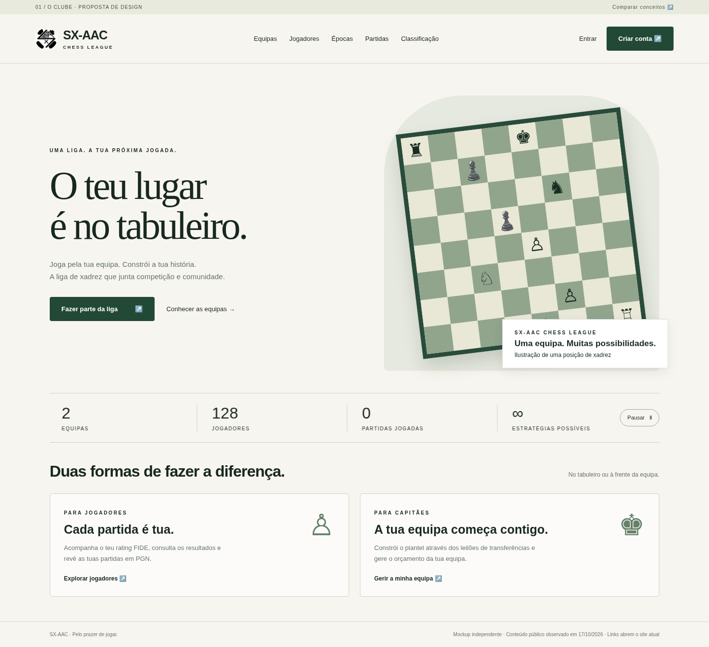
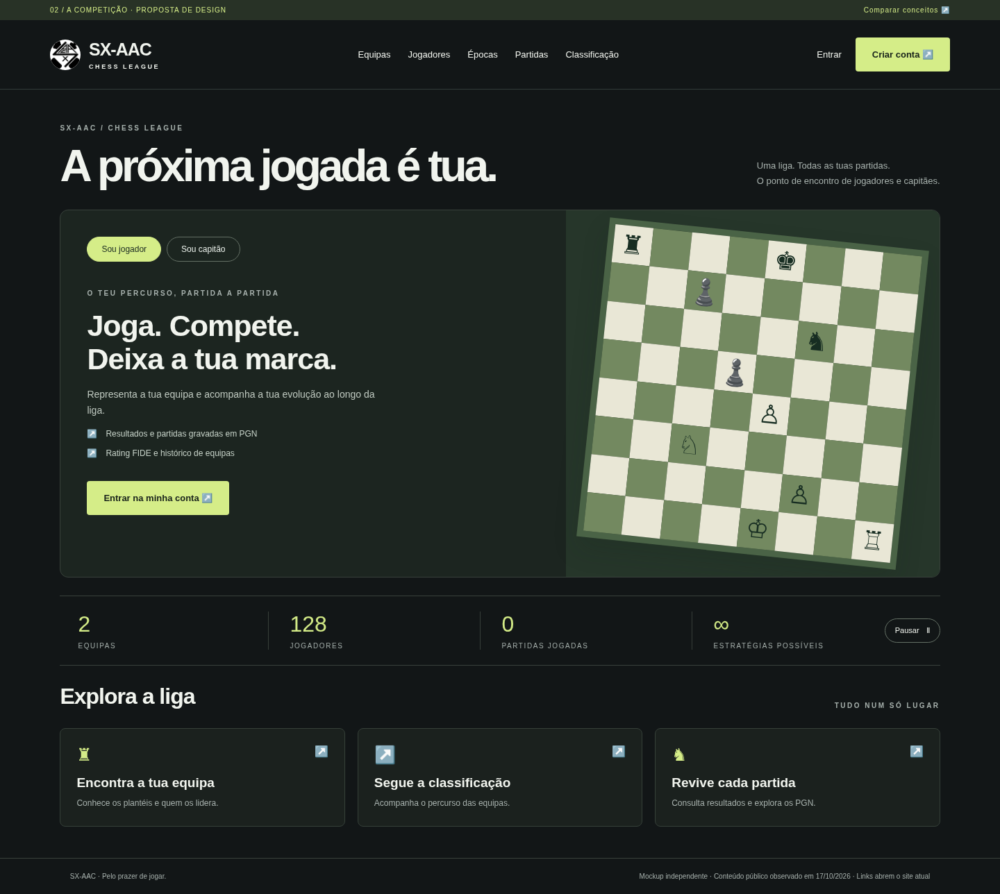

# SX-AAC — two homepage redesigns

Two responsive HTML/CSS mockups based on the public homepage at https://liga.sx-aac.com/, inspected on 17 October 2026. No changes were made to the original site.

## 01 — O Clube
Warm ivory and forest green, editorial typography, community and registration focus.

## 02 — A Competição
Charcoal and lime, interactive player/captain tabs, direct access to league features.

Open `index.html` for the gallery. No build or dependencies required. All assets are local. Account and competition links lead to the original website. Figures are a snapshot, not live data; chess positions are illustrative. The SX-AAC logo is sourced from the original site for these redesign proposals; no endorsement is implied.

Mobile previews: [Concept 01](assets/concept-01-mobile.png) · [Concept 02](assets/concept-02-mobile.png).

The statistics scroll horizontally in a seamless loop in both concepts. Hover or keyboard focus pauses the motion; the pause button keeps it paused. Reduced-motion preferences display a static grid. Counts remain the original snapshot.
